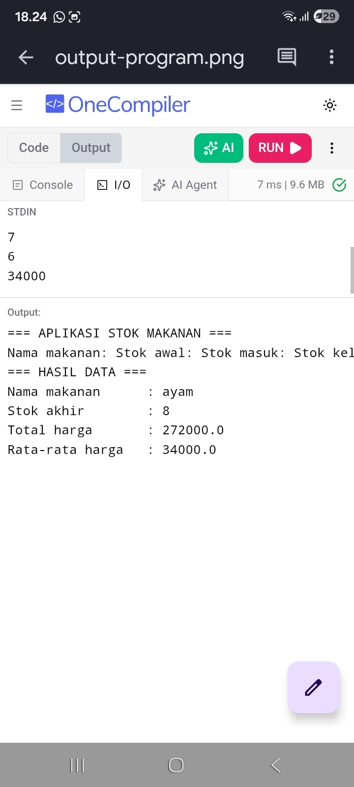

# [Stok Bahan Makanan]
Project Ujian Tengah Semester (UTS) mata pelajaran Pemrograman Dasar /
Koding & Kecerdasan Artifisial kelas X PPLG. Aplikasi ini dibuat dalam
dua versi bahasa pemrograman, yaitu **C** dan **Python**.
## Identitas Siswa
* **Nama Lengkap:** [Ardiyansah Saputra]
* **Kelas:** X PPLG
* **No. Absen:** [03]
## Deskripsi Aplikasi
[Aplikasi Stok Makanan adalah aplikasi sederhana yang dibuat menggunakan bahasa Python untuk mengelola persediaan makanan. Aplikasi ini berfungsi menghitung stok makanan yang tersedia, sehingga memudahkan pengguna mengetahui jumlah stok akhir dan nilai harga makanan.

Fitur yang terdapat di dalam aplikasi:
Memasukkan nama makanan.
Menginput stok awal, stok masuk, dan stok keluar.
Menghitung stok akhir makanan.
Menghitung total harga stok makanan.
Menghitung rata-rata harga.]
## Daftar File
* `stokmakanan.c` : Kode program utama menggunakan bahasa C.
* `stokmakanan.py` : Kode program utama menggunakan bahasa Python.
* `Screenshot_20261119_182418_Drive.jpg` : Screenshot hasil menjalankan program aplikasi.
## Screenshot Output Program

